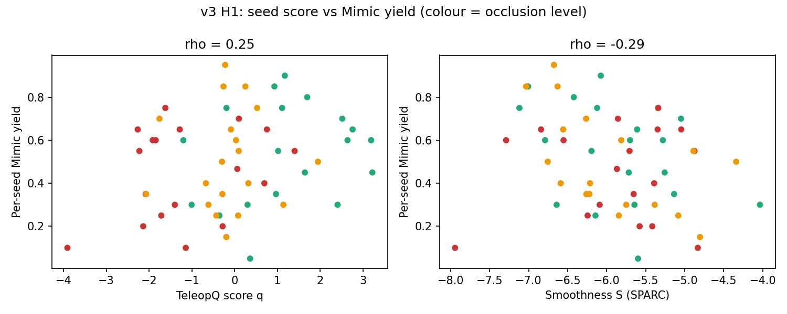

# TeleopQ v3 — Seed score and H1

**Question (H1):** does the TeleopQ score of a seed demonstration predict how useful that seed really is, better than
action smoothness alone?

**Answer:** yes, by the pre-registered test (ρ(q) − ρ(S) = **+0.54**, 95% CI **[0.24, 0.83]**). But much of the gap
comes from smoothness predicting value *backwards*, and latency alone predicts better than the combined score.
Details and caveats below.

**Status:** complete (Nov 16, 2026). 56 seeds from 27 degradation conditions; each seed's value measured with ~20
Mimic attempts.

## Pipeline

| Step | What happens | Script | Output |
|---|---|---|---|
| 1. Occlusion injector | Added to the scripted operator (v2) and tested: none / partial / heavy | `tq_generate.py`, `run_occ_test.sh`, `tq_occ_check.py` | `logs/occlusion_test/` |
| 2. Seed pool | Scripted operator over the full grid: latency {0, 100, 250 ms} × occlusion {none, partial, heavy} × jitter {0, 5, 15 mm}, ≥ 2 successful seeds per condition | `run_v3_pool.sh` | 56 seeds, `logs/seed_pool/` |
| 3. Label + score | Label each seed for Mimic (`tq_annotate.py`), split into single-seed files, match each seed to its operator-log episode (all matched at 0.0 mm), compute every score | `tq_pool_scores.py` | `results/scores.csv` |
| 4. Seed value | Mimic is given each seed **alone**; stopped after ≥ 20 attempts; yield = successes / attempts | `run_v3_yield_v2.sh` | `logs/yield/`, `results/merged.csv` |
| 5. H1 analysis | Spearman ρ of every scorer with yield, 1,000-sample bootstrap CIs, key test, partial correlations, plot | `tq_h1.py` | `results/h1_*.{json,md}`, `results/q_vs_yield.png` |

## Score definitions

| Term | Definition |
|---|---|
| **V** (visibility) | Mean v_t over the contact windows: ±10 steps (±0.5 s) around the right hand's close and open events. v_t = fraction of the object's 8 bounding-box corners whose line of sight from the head (`head_yaw_link`) is not blocked by the occluder |
| **L** (latency) | Mean age (env steps) of the hand frame the operator saw when each command was sent, read from the operator's per-step log. This is the feed delay; occlusion freezes are logged separately so L and V stay distinct |
| **S** (smoothness) | SPARC of the right-hand speed profile. **Correction to the plan:** the plan wrote S = −SPARC with "higher = better", but SPARC is closer to 0 when motion is smoother, so −SPARC would reward jerky demos. We use **S = SPARC** (higher = smoother) |
| **q** | z(V) − z(L) + z(S), z-scored over the 56 seeds |
| Baselines | q without V; action high-frequency power (PSD, share > 2 Hz, negated); kNN typicality (negated mean distance to the 3 nearest seeds' object-relative hand paths); episode length (shorter = better); oracle (negated sum of z-scored injected levels) |

## Occlusion design

The occluder is a virtual plate that blocks only the operator's view (no physics). At each episode start it is placed
60% of the way from the head to the object: *partial* = off-centre, half-size 9 cm (hides about half the object);
*heavy* = centred, half-size 12 cm. Each step the operator gets a fresh frame with probability v_t; otherwise its view
of the hand stays frozen at the last fresh frame.

A first version froze the view only when v_t < 0.5. Partial occlusion hides exactly 4 of 8 corners during the grasp
(v_t = 0.50), so it never triggered: partial and none both gave 10/17 = 58.8% yield, heavy 10/50 = 20.0%
(`logs/occlusion_test/`). The graded rule above replaced it before the seed pool was generated.

## Results

### H1 (56 seeds, mean yield 49.9%)

| Scorer | Spearman ρ with yield | 95% bootstrap CI |
|---|---|---|
| **TeleopQ q = z(V) − z(L) + z(S)** | **0.250** | [0.004, 0.476] |
| TeleopQ without V | 0.160 | [−0.066, 0.385] |
| Smoothness S (SPARC) | **−0.293** | [−0.528, −0.044] |
| Visibility V alone | 0.219 | [−0.053, 0.458] |
| Latency (−L) alone | **0.447** | [0.204, 0.646] |
| Action high-freq power (PSD) | −0.129 | [−0.389, 0.128] |
| kNN trajectory typicality | 0.354 | [0.100, 0.560] |
| Episode length (shorter = better) | 0.255 | [−0.023, 0.488] |
| Oracle (injected severity) | 0.440 | [0.204, 0.618] |

**Key test:** ρ(q) − ρ(S) = **0.543**, 95% CI **[0.240, 0.833]**, which excludes 0, so **H1 is supported**.
Partial ρ(V, yield | S, length) = 0.149; ρ(length, yield) = 0.255.

*Left: TeleopQ score; right: smoothness. Colour = occlusion level (green none, orange partial, red heavy).*

### Yield by factor (mean over conditions)

| Latency | 0 ms | 100 ms | 250 ms |
|---|---|---|---|
| Mean seed yield | 61.8% | 50.3% | 36.9% |

| Occlusion | none | partial | heavy |
|---|---|---|---|
| Mean seed yield | 54.4% | 49.7% | 44.8% |

Per-condition yields are in `results/h1_results.json`.

## Findings

1. **H1 passes as defined:** the TeleopQ score ranks seeds by their real value better than smoothness does.
2. **Smoothness ranks seeds backwards.** Smoother seeds had *lower* yield (ρ = −0.29, CI entirely below 0). Under
   latency and occlusion, only the calmer attempts succeed, so the surviving degraded seeds look smooth. This confirms
   the survivor-bias effect first seen in v2, now against measured seed value: action smoothness alone can mis-rank
   teleoperated demos.
3. **Because S enters q with the wrong sign, q (0.25) is weaker than latency alone (0.45).** A score without S, e.g.
   z(V) − z(L), is the natural candidate for v4. It is reported as a finding, not substituted after seeing the data.
4. **Visibility (H3) is weak at the seed level:** ρ(V) = 0.22, CI touches 0; 0.15 after controlling for S and length.
   Occlusion still lowers yield on average (54% → 45%). v4 tests H3 at the policy level.
5. **Each injected factor lowers seed value monotonically** (latency strongly, occlusion moderately).

## Limitations

- 56 seeds, ~20 attempts each: each yield has about ±20 points of sampling noise; correlations have wide intervals.
- Scripted operator, one task (GR-1 pick-and-place of a steering wheel), one simulator.
- V uses geometric line-of-sight to a virtual occluder, not rendered camera images; no field-of-view check.
- Seeds exist only for successful operator attempts (Mimic keeps successes), which is the source of the survivor bias.
- Contact events come from the right hand's finger commands; the subtask boundary rule is calibrated on NVIDIA's 5 seeds.

## Engineering notes

- One simulator may initialize at a time (two at once crashed in v2). The yield runner uses a start-up lock and
  three lanes.
- The first yield runner could not enforce the 20-attempt cap because simulator output was buffered; fixed with
  `PYTHONUNBUFFERED=1` (`run_v3_yield_v2.sh`). The one seed run before the fix used 45 attempts (21/45), which is kept.

## Files

| Path | Contents |
|---|---|
| `scripts/` | All code: operator with occlusion, pool, scoring, yield runner, H1 analysis |
| `logs/occlusion_test/` | Occlusion injector test logs and check |
| `logs/seed_pool/` | One generation log per condition + batch log |
| `logs/yield/` | One Mimic log per seed, lane logs, per-lane result CSVs, scoring output |
| `logs/h1.txt`, `logs/checksums.txt` | H1 output; SHA-256 of every file, dataset and operator log |
| `results/` | `scores.csv`, `merged.csv`, `h1_results.json`, `h1_table.md`, `q_vs_yield.png` |
| `PROOF.md` | Claim → evidence index |

Datasets (`.hdf5`) and operator logs (`.npy`) are not in git; they are identified by hash in `logs/checksums.txt`.
